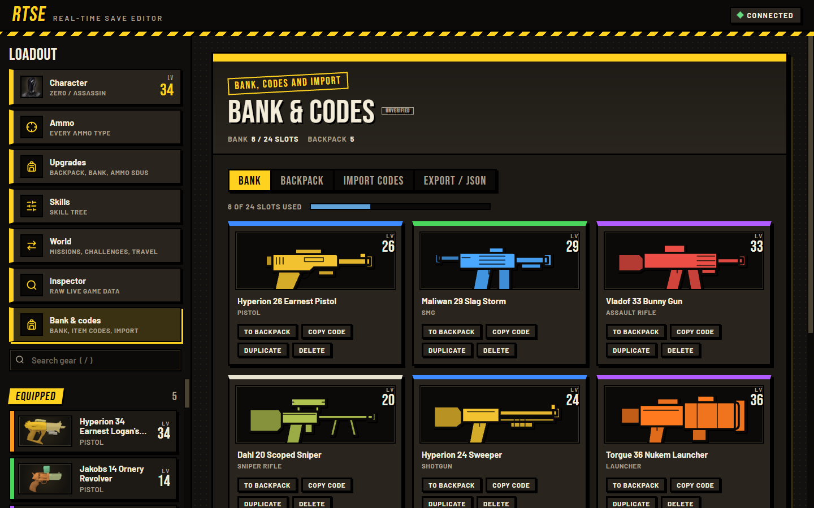
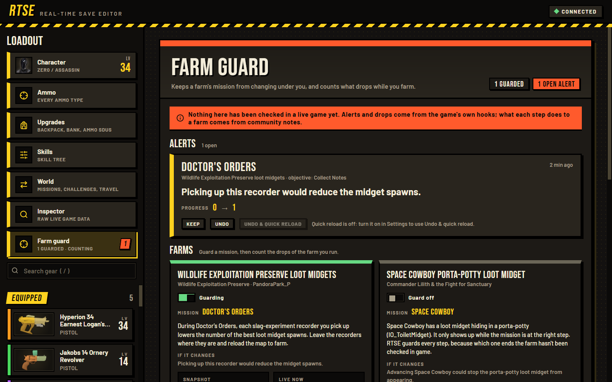
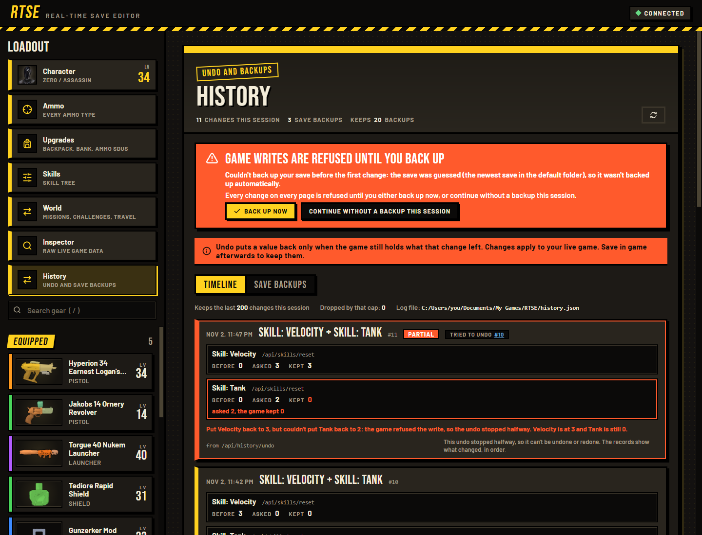
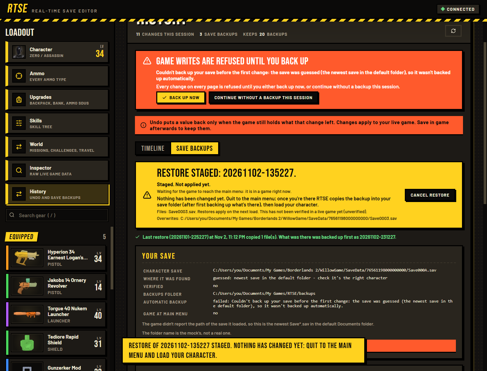

# RTSE

A save editor for Borderlands 2 that works while you're playing.

You don't quit the game, find your save file and edit it in some other tool. You hit **F8** in game, a page opens in your browser, and whatever you change shows up in the game right away. Change a gun's parts, bump your level, fill your ammo, unlock a fast travel station, whatever. Save in game like normal and it sticks.

It runs on the [bl-sdk](https://bl-sdk.github.io/willow2-mod-db/) mod loader, so it's just one more mod in your `sdk_mods` folder.

## What you can do with it

- **Gear:** open any weapon or item in your backpack or equipped, swap its parts, change its level, tweak its stats. There's a 3D view of the gun that updates as you go.
- **Character:** level, XP, skill points, cash, eridium, seraph crystals, torgue tokens.
- **Ammo:** see and set every ammo type.
- **Upgrades:** backpack, bank and ammo SDU levels, like the Gibbed editor has.
- **Skills:** your real skill tree for your class. Set any skill to any rank (even locked ones), change unspent points, or reset the whole tree.
- **World:** missions (including how far through each objective you are), challenges, fast travel stations and playthrough (Normal / TVHM / UVHM).
- **Inspector:** browse the game's own live data and change plain numbers, switches and text in it, for the things that don't have a page of their own.
- **Weapon lab:** snapshot a gun, swap a part, and see every stat that changed side by side. Then record the damage you actually deal (hits, crits, DPS, per-pellet) and chart it.
- **Bank & codes:** copy any item as a `BL2(...)` code (the format the Gibbed editor uses), paste codes to add items, look through your bank, move items between backpack and bank, duplicate or delete them, and save or load your whole inventory as a JSON file.
- **Farm guard:** protects a farm that a mission step would ruin (the Wildlife Exploitation Preserve loot midgets in Doctor's Orders, the Space Cowboy porta-potty midget). It warns you, then lets you keep the change or undo it. It also counts attempts, time and drops while you farm.
- **History:** every change RTSE made, what you asked for and what the game kept, with **Undo**. Your save file is backed up before your first change each session, and you can back up or restore it yourself.
- **Builds:** save your gear, skills and character as a named build, preview exactly what applying it would change, then apply it. Share builds as a JSON file or a link, and export or import a whole character.

## A tour of the editor

The screenshots below were taken with the demo data from `dev/mock_server.py` (see [For tinkerers](#for-tinkerers)), not from a live game, so the names and numbers are placeholders. In the real thing they come from your character.

The left side is always your **Loadout**: ten pages pinned at the top (Character, Ammo, Upgrades, Skills, World, Inspector, Weapon lab, Bank & codes, Farm guard, History), then a search box and everything you have equipped or in your backpack.


### Gear

Click any weapon, shield, grenade mod, relic or class mod in the list.


- **3D view.** Drag to orbit, or use **Side / Angle / Top / Blueprint**. Click a part on the model to swap it. Colours show which manufacturer made each part.
- **Level.** Change the item's level with the stepper and hit **Set**.
- **Part slots.** One tile for each slot (body, grip, barrel, sight, stock, element, accessories, material). Empty slots are dashed. Click a tile to swap that part.


- **Part picker.** **Legal** shows only parts this gun could roll in the game. **Any gun** shows parts from other guns of the same type. **Everything** shows every part in the game. You can search by name, maker or element, filter by manufacturer, and see a preview of the gun with the part on it. Double-click a part to bolt it on, or **Remove current part**.


- **Check before apply.** Every part in the picker has a status chip, and you can filter by it:
  - **Could drop naturally**: the part is in this item's own balance list for that slot (including lists inherited from a parent balance), its drop weight is above 0, and it isn't limited to other manufacturers.
  - **Needs DLC**: only DLC gear uses it. The chip's tooltip names the DLC and says whether the game thinks you own it.
  - **Custom**: it comes from another gun's or item's balance, or it's in this item's list but can't drop on it (drop weight 0, or only for other manufacturers).
  - **Unknown weight / DLC unknown**: RTSE couldn't read the part's drop weight, or couldn't tell whether a part from another balance needs a DLC. RTSE won't guess either way.
  - **Unsupported**: the wrong kind of part for this item, e.g. a grenade part on a shield.

  Click a part and the preview's **CHECK BEFORE APPLY** box shows its status and why. Nothing is asked of the game. A save/reload check is coming back later as an offline round-trip using the serial decoder from `rtse/item_serial.py` (PR #10), with no game calls.
- **What the game kept.** After you swap a part or change the level, a panel above the gun shows what the game actually kept: the name, every part that changed, the stats that moved, and the game's own `CanBeSaved()` answer (weapons). Close it with **x**.
- The picker says how long ago the part list was scanned. RTSE rescans by itself when the map changes. Press **Rescan** after loading DLC.
- **Stats bench.** The gun's real numbers (damage, magazine size, reload time, spread, range and so on) with the game's base value next to each one. Type a number and **Set**, or use **/2, x2, x10**. Your tuned values are saved in `rtse/overrides.json` and re-applied whenever the game rebuilds that weapon.
- **Item info & dev tools** (below the stats) has the item's id, class, level requirement and game stage, plus the **Save ... dump** buttons for bug reports.

### Character


Your level and XP, plus unspent **skill points**, **cash**, **eridium**, **seraph crystals** and **torgue tokens**. Each one has a box to type an exact value and **Set**, quick **+** buttons, and **Max** where it makes sense. The game caps cash and tokens at two billion.

### Ammo


One card per ammo type with how much you have, your capacity and how full that is. **Set** an exact amount, **Fill** to capacity, **Empty** it, change the capacity directly, or change the ammo SDU level. **Fill everything** tops up all types at once.

### Upgrades


Your SDU (Storage Deck Upgrade) levels, the same idea as the Gibbed editor. **Backpack** and **Bank** slots, and **Ammo capacity** for every ammo type. Step the level up or down, **Set** it, or **Max** it. **Max everything** does the lot. Each card says where the game's number came from.

### Skills


The real skill tree for your class (Zer0 in this picture), straight from the game's own data. Your action skill is at the top. Click any skill to read what it does and set it to an exact rank with the stepper, **Max** or **Zero**. This ignores tier locks, so you can put points into locked skills. It doesn't spend skill points. You can also set your **Unspent** points, or **Reset tree**.

Tick **Allow above max** to go past a skill's normal maximum rank (up to 255). The game never offers ranks like that, so it might cap the number, ignore it, or act strangely. Each change still reports what the game says afterwards, and this hasn't been tried in a live game yet, so back up your saves.

### World

The **World** page has four tabs.


- **Missions.** Every mission, grouped by storyline, with its state. Pick the playthrough (PT1 Normal, PT2 TVHM, PT3 UVHM) and filter by Active, Ready, Not started, Complete or Failed. Search by name. **Reset** one mission, or **Complete all shown / Reset all shown** for whatever the filters currently show.


- **Challenges.** Each challenge with a progress bar. **Complete** or **Reset** one at a time, or everything shown.


- **Fast travel.** Every fast travel station, locked or unlocked. **Unlock** or **Lock** one, or **Unlock all shown**.


- **Objectives (on each mission).** Click **Objectives** on a mission to see its objectives and how far along each one is, like "2 / 4". Type a number and **Set**, or use **Max** and **Zero**. If a mission has several stages, the **Stage** buttons move it between them, and **Track on HUD** makes it your tracked mission. Objectives that aren't part of the current stage are dimmed.

- **Playthrough.** Shows which playthrough you're in and lets you switch between Normal, TVHM and UVHM. Read the note on that page first: save and reload afterwards, since switching mid-playthrough can leave your mission log out of step.

### Inspector


The closest thing to the raw tab in the Gibbed editor, except it shows the live game instead of a save file. Start from your player controller, your character's body, the skill tree, the mission tracker and a few other objects, and click through into their fields, lists and sub-objects (the trail at the top shows where you are). Every field shows the game's real name, its type and its current value.

- You can change whole numbers, decimals, true/false, text and enum values (type the enum's number). References, structs and lists are read-only here, and nothing in the game is ever called.
- This skips every check, so a wrong value can confuse the game or crash it, and some fields will do nothing. Back up your saves first.
- It's also the quickest way to find out what the game really holds when one of the other pages says "unavailable".

### Weapon lab


Two halves:

- **A/B compare.** Pick a weapon and press **Snapshot A**. Swap parts right there (the part pickers use the same edit as the Gear page, so the change is real), then press **Snapshot B**, or skip B to compare A with the gun as it is now. The table lists every stat with A, B, the change and the % change, and which parts differ. The two bottom rows, damage per shot and "card DPS", are worked out from the stats (damage x pellets / fire interval), so they're marked **estimated**.
- **Measured damage.** Press **Start**, shoot something, press **Stop**. While it records, the page shows hits, crits and crit rate, total damage, DPS, average and max hit, crit vs non-crit, shots, pellets per shot, per-pellet damage, hits per shot and kills, plus a chart of every hit (crits in red) and the damage in the last second. Pick a **Target** to see one enemy only: its DPS is timed over that enemy's hits, and the shot-based tiles (shots, pellets, per pellet, hits per shot) read "all targets only", since a shot can't be tied to an enemy. **Only this weapon** skips hits and shots from your other guns. Every hit is kept up to the **Cap** (default 2,000; the oldest drop off after that), and **Reset** clears them without stopping.

Where the numbers come from: each hit is the game's own damage summary for that hit, read when the game tells the player controller it dealt damage (`NotifyDamageDealt`). Shots are counted when your gun uses ammo (`ConsumeAmmo`). If the first never fires, RTSE falls back to the damage passed to each enemy's `TakeDamage`, which is before armour and resistances, and the page then says every damage number is an estimate. Each hit is recorded once. The fallback only records until `NotifyDamageDealt` has fired once since the mod was loaded, and then it stays off, so at most the first few hits of your very first recording may come from it (marked estimated).

Which gun a hit belongs to comes from the game's `DamageCauser` on `TakeDamage`: the gun itself for bullets, or the gun that owns the projectile for rockets and grenades from a launcher. When the game gives no causer, the hit is credited to the gun you're holding when it lands. That's approximate (a rocket or burn landing after you swap guns counts for the new gun), so the page says how many hits were credited that way, and **Only this weapon** keeps them rather than guess. Tiles that are arithmetic over the readings (crit multiplier, per-pellet, hits per shot, kills) are always marked **estimated**. The hooks only do any work while a recording is running.

**In-game test checklist** (nobody has run this in the game yet; please try it and send the lab dump):

1. Open **Weapon lab**, pick an equipped gun, **Snapshot A**. Change its barrel with the part picker. The table should show B (live) values that differ, and the barrel under Parts. Check in game that the gun really changed.
2. **Snapshot B**, then swap the barrel back. The table should still compare A with the saved B.
3. **Start**, then fire single shots at an enemy. **Hits** should go up about once per shot (a shotgun: up to once per pellet), and **Shots** once per trigger pull. If Shots stays at 0, `ConsumeAmmo` isn't firing.
4. Compare a few hits with the damage numbers floating in the game. Shoot a weak spot: those hits should be counted as crits.
5. Hit a shielded enemy: **Total damage** should mention "shield absorbed".
6. Kill something and check **Kills** goes up.
7. Tick **Only this weapon**, then shoot with another gun: Shots shouldn't move and no hits should be added. If hits still appear, check the "credited to the held weapon" note: those hits had no causer.
8. Fire a rocket or a slow projectile and swap guns before it lands: the hit should still count for the launcher. If the page says those hits were "credited to the held weapon", the causer isn't reaching RTSE. Note that down.
9. Watch the "Hooks" line: `NotifyDamageDealt` should be counting. If only `TakeDamage` counts, the page shows the "pre-mitigation estimate" banner. Note that down.
10. Press **Save lab dump** and send `rtse/debug_lab.json` (it holds the raw damage summary fields of the first 20 hits).
11. Press F8 twice and toggle the mod off and on in the mod menu, then record again. Hits must not be counted twice.
### Builds

Save a named build of what you have now. Pick what goes in: **Equipped gear**, **Backpack gear**, **Skills**, **Level & skill points** and **Currencies**. **Export whole character** downloads everything (all gear, every skill, level, XP, skill points and currencies) as one JSON file.

- **Share.** Each build has **Download JSON** and **Copy link**. A link is a compact `RTSE-L1:...` string, the same build compressed. **Import** takes a `.json` file or a pasted link or JSON.
- **Preview first.** **Preview** is a dry run. It lists every change (before and after), what already matches, gear the build has that you don't (**missing**), and anything it **can't apply** with the reason: wrong class for the skills, a skill above its maximum (tick **Allow above max**), a level above the cap, a part the game hasn't loaded, or an item in the wrong place. RTSE can't equip or unequip items, so it tells you to do that yourself. Untick sections or single items to leave them out.
- **Matching.** Gear is matched by item type and balance (which gun or item it is), then by how many parts already match. The item's `UniqueId` isn't used, because it changes when an item is rebuilt or re-imported. Each item you own is used for one build entry at most. Missing items are reported, never spawned. **Import from item code** appears once the item-codes feature lands.
- **Apply.** Every change runs through the same functions as the Gear, Skills and Character pages, so each one gets the same checks, readback and rollback. **Apply** only starts if the game still matches the preview (XP included). Otherwise it asks you to preview again. It runs in **chunks** of up to 20 changes or about 2 seconds, so the game never freezes for long, and the page shows the progress. Each chunk is its own entry in **History**. Before each chunk RTSE checks that nothing changed since the last one. If something did, it stops and writes nothing more. If a step fails, RTSE stops. By default it undoes the steps of that chunk that worked, newest first. Earlier chunks stay applied, and the result says which ones, so you can undo them from History. Pick **Keep them** to leave the failing chunk's earlier steps in place too. The result lists every step as ok, failed, rolled back, rollback failed or not run. If it says *rollback failed*, reload your save before playing.
- **Partial builds.** If part of your build can't be read (say, a currency or the skill tree), RTSE asks before saving it and marks it **partial**, with a note of what was left out. A partial **Export whole character** asks before downloading and ends in `-partial.json`.
- Builds are stored in `rtse/loadouts.json`. Imported files and links are checked strictly: the format and version must match (`rtse.loadout` version 1), unknown fields are refused, and size limits apply (100 builds; each build must fit a 56,000-character link, so every build can be shared and imported again within the server's 64 KB request limit). Leveling up through a build also resets XP to that level's minimum; the preview shows it.

**In-game test checklist** (none of this has been run in the game yet):

1. Save a build with only equipped gear. Change a part and the level on one equipped gun in the Gear page. **Preview** should show exactly those two changes. **Apply** them, then check the gun is back as it was.
2. Save a build with skills and level & skill points. Change a few skill ranks, then preview and apply. Check the skill tree and unspent points.
3. Move a build gun from equipped to the backpack. The preview should show a location note and still plan its parts.
4. Sell or drop a build item. The preview should list it as missing and change nothing for it.
5. Load a character of another class. The skills section should be blocked as "this build is for ...".
6. **Export whole character**, then import the file on the same character. The preview should show no changes, or only XP.
7. Copy a link, delete the build and import the link. You should get the same build back.
8. Press **Debug dump** and attach `rtse/debug_loadouts.json` to any bug report.

### Bank & codes



Four tabs, all marked **unverified** until someone tries them in game:

- **Bank.** Everything in your bank as gear cards, with **To backpack**, **Copy code**, **Duplicate** and **Delete** on each. A big bank is read a slice at a time so the game never stalls: cards not read yet say **Not decoded yet** and the tab shows **Reading bank... N left** until they are all in.
- **Backpack.** Your backpack (and, read only, what you have equipped) with **To bank**, **Copy code**, **Duplicate** and **Delete**. Equipped gear can't be deleted or moved; unequip it first.
- **Import codes.** Paste one or many `BL2(...)` codes. Labels, bullet points, markdown and line breaks inside a code are ignored. **Preview** shows what each code is before anything is added, and flags codes that were copied wrong (their checksum fails). Pick **Backpack** or **Bank** and **Import**. Every imported item gets a fresh UniqueId, so importing the same code twice gives two separate items (two items sharing a UniqueId cause trouble, see Gibbed issue #154).
- **Export / JSON.** **Download inventory JSON** saves every equipped, backpack and bank item as a code in `rtse-inventory.json`. **Copy all codes** puts them on the clipboard, one per line. **Import JSON file** reads such a file back, with a preview, into the backpack, the bank or each item's original place. It only adds items, it never replaces any. Equipped items in the file are skipped (you still have them equipped) unless you tick **Also add equipped items to the backpack**. Big pastes and files are worked through in small batches, with progress shown, so the game never stalls.

Delete asks for a second click, and RTSE refuses to delete an item unless its code decodes back to the exact same item, so **Restore** (under **Deleted this session** on the Import tab) can always bring it back. Moves add the item at the other end first, check it arrived with the same UniqueId, and only then remove the original. If anything doesn't match, the change is undone. Taking an item out of the bank uses the game's own removal; if that takes an identical twin too, the twin is put back and checked. Only if the game's removal does nothing does RTSE edit the bank's list directly, and then it says so (**unverified: direct array edit**), because nobody has checked yet that the game keeps that edit.

### Farm guard

Some farms only work while a mission stays at one step. In the **Wildlife Exploitation Preserve**, every slag-experiment recorder you pick up for **Doctor's Orders** lowers the number of the best loot midget spawns. In **Commander Lilith & the Fight for Sanctuary**, the **Space Cowboy** porta-potty loot midget only turns up while that mission is at the right step. Farm guard watches those missions for you.



- **Enable** a profile and RTSE takes a snapshot of that mission's full state (status, objective counts, objective set and sub-sets, playthrough). The snapshot is tied to your save: its save file number, class and character name, plus the save's GUID when the game shows it. If RTSE can't read the playthrough or tell which save this is, it won't snapshot or undo anything.
- When the game changes the mission, an alert says what it costs ("Picking up this recorder would reduce the midget spawns."). Pick **Keep** (accept it, and the snapshot moves on), **Undo** (put the snapshot back), or **Undo & quick reload**.
- **Undo is all or nothing.** The game keeps two copies of a mission (the live one and the one your save is written from), and undo needs both, exactly as the snapshot saw them. If a copy is missing, or any value can't be read, nothing is changed. If the game refuses any part of the undo, or doesn't keep a value, RTSE puts every field back the way it was just before, leaves the alert open and lists anything it couldn't put back.
- **No undo after a turn-in.** Once either copy of the mission says it's turned in, its rewards (XP, cash, items) are already yours and can't be taken back, so the alert only offers **Keep**, and keeping it switches the guard off. The same goes when RTSE can't read the mission's state. A mission that's already turned in can't be guarded at all: the farm is over.
- **Quick reload** is experimental and off by default. It saves, quits to the title screen and loads the same playthrough straight back in, so the map reloads with the restored mission. It only runs when the game is in a safe state (your character spawned, no loading screen, not saving). Otherwise it refuses and tells you why. If the game stays on the main menu, press **Continue** yourself.
- **Auto-block** (per profile, off by default) stops the change before it happens instead of undoing it afterwards. For Doctor's Orders it also stops the recorder pickup itself, so the recorder stays on the floor.
- **Farm tracker:** start a session to count attempts (reloads are counted automatically), time it, and list the drops you pick up that match the profile (blue and better by default).
- Co-op: only the host's game runs missions, so farm guard only works when RTSE can confirm it's a solo game or you're hosting. As a client in someone else's game, or when it can't tell, it turns itself off with a note.
- The profiles live in `rtse/farm_profiles.json`. The mission names in it come from the game's own files; what each step does to the farm comes from community farm notes.

**In-game test checklist** (nobody has run this in the game yet, so please try it and send the farm dump):

1. Load a character with Doctor's Orders active, open **Farm guard**, enable *Wildlife Exploitation Preserve loot midgets*. The snapshot should show the mission as Active with its objective count.
2. Pick up one recorder. An alert should appear within two seconds and the live progress should read one higher than the snapshot.
3. **Undo**. The progress should go back, and the mission log in game should show the old count. Save-quit and continue: is the count still the old one, and are all the midgets back?
4. Turn on **Quick reload**, pick up a recorder, use **Undo & quick reload**. The game should save, quit and load straight back into the same playthrough.
5. Turn on **Auto-block**, try to pick up a recorder. It should stay on the floor (or the count shouldn't move), and a "Blocked" alert should appear.
6. Start a tracker session, kill the midgets, pick up some loot. Blue and better gear should show up in the drop list, and the attempt count should go up after a reload.
7. Repeat 1-3 for Space Cowboy in Fight for Sanctuary and note which step makes the porta-potty midget stop appearing.
8. Join someone else's co-op game: the page should say farm guard is off for clients.
9. Press F8 twice and disable and re-enable the mod, then check the farm dump: each hook must be listed once.
10. Click **Save farm dump** (dev tools at the bottom of the page) and attach `rtse/debug_farm.json` to your report.

### History



- **Timeline.** Every change RTSE made to your game, newest first: what it was before, what you asked for and what the game actually kept. If you asked for 900 and the game kept 600, it says so.
- **Undo.** Puts the old value back, using the same write as the page you made the change on, so it gets the same checks. It only works on the character the change was made to: each change remembers the save, class and name, and the undo is refused on any other character, or when RTSE can't tell who is loaded. It also only works when the game still holds exactly what that change left, all of it: a level change counts as level and XP together, and a skill tree reset as every skill's rank. If anything changed since (you, the game or another change), the undo is refused instead of overwriting the newer value. An undo shows up on the timeline too, and undoing an undo redoes the change. If an undo fails halfway, RTSE puts back what it had already changed, and if even that fails, the timeline gets a "partial" entry listing exactly what changed.
- **What can be undone:** gear parts, gear level, gun stats, character values, ammo, SDUs, skill ranks and a skill tree reset. **World** changes (missions, objectives, challenges, fast travel, playthrough), **Inspector** writes and **Bank & codes** changes (items added, duplicated, deleted or moved) are listed but can't be undone: a mission or a raw field ripples into other game state, and moving items reshuffles your backpack and bank, so putting one value back isn't safe. A deleted item's code is shown in its entry, so you can paste it back on Bank & codes. Otherwise, restore a save backup.
- The timeline keeps the last 200 changes and is also saved to `rtse/history.json`, so after a restart you can still see the last session's changes (they can't be undone any more).



- **Save backups.** Before your first change each session (and for each character you change), RTSE copies that character's `.sav` and your `profile.bin` into `rtse/backups/<date-time>/`. **Back up now** makes one whenever you like. It only ever reads your save folder.
- The page says where it found your save: read from the game, the file name from the game with the folder guessed, or a guess (the newest save in `Documents\My Games\Borderlands 2\WillowGame\SaveData`).
- **No backup, no change.** RTSE only backs a save up on its own when the game told it which file is yours. If it could only guess, or the copy failed, your first change is refused with "Couldn't back up your save before the first change: ...". Open History > Save backups, check the path, and either **Back up now** or choose **Continue without a backup** for this session.
- **Keep** sets how many backups to keep (20 by default, 1 to 200). The oldest go first. Backups a restore still needs are kept no matter what, and so is a safety copy from a restore that went wrong, until you **Unpin** it.
- Each backup shows the file a restore would overwrite. If that isn't the save RTSE found for your current character, the page warns you.
- **Restore…** never touches your save while you're playing. It's staged: quit to the main menu (the game saves on the way out). RTSE writes it only when you're on the main menu with no character loaded and the save file hasn't changed for 5 seconds. It copies what's there to a safety backup first, replaces each file in one step, checks it, and checks again 5 seconds later. If any step fails, your original files are put back from the safety backup. If the game wrote over the restored file, the page says so and keeps the safety backup. Then load your character. Tick **also restore profile.bin** only if you want your profile (settings, badass rank, golden keys) back too. **Cancel restore** drops a staged restore. The restore's progress is saved to disk, so if the game closes mid-restore, RTSE puts your original files back the next time it runs. Writing the restore briefly pauses the game at the main menu: RTSE checks it's safe and writes the files in one go, so the game can't load or save in between. Save files are small, so the pause is short, and the restore result says how long it took.

## Heads up before you start

- **Back up your saves first.** They're in `Documents\My Games\Borderlands 2\WillowGame\SaveData`. Copy that folder somewhere. It takes ten seconds and saves you if you break something. RTSE also backs up the character you're editing before its first change each session (see [History](#history)), but your own copy of the whole folder is the safe one.
- **Play solo.** Don't use this in public online games.
- **This is early.** Gear is the page that's had the most real use. Character, Ammo, Upgrades, Skills, World (including objectives) and Inspector were built from the game's own data files, so the names they use are real, but nobody has confirmed every button does what it says in a live game yet. If something shows "unavailable" or does nothing, see [When something doesn't work](#when-something-doesnt-work).

## Easiest way to install: let Claude do it

Send this repo to Claude (Claude Code works great, since it can touch your files) and say something like:

> Install RTSE from https://github.com/zuhuHix/Bl2_RTSE into my Borderlands 2. Set up the bl-sdk mod loader first if I don't have it.

It'll find your game folder, set up the mod loader if needed, and put RTSE in the right place. Other coding assistants that can work on your computer will do the same job.

## Install it yourself

1. **Get the mod loader (bl-sdk) if you don't have it.**
   - Install the latest [Microsoft Visual C++ Redistributable](https://learn.microsoft.com/en-us/cpp/windows/latest-supported-vc-redist) if you haven't.
   - Download the latest release from [bl-sdk/willow2-mod-manager](https://github.com/bl-sdk/willow2-mod-manager/releases) (the release zip, not "Source code").
   - Unzip it straight into your Borderlands 2 folder, usually `C:\Program Files (x86)\Steam\steamapps\common\Borderlands 2`. Let it merge with what's there.
   - Start the game once. If you see a **MODS** option on the main menu, it worked.
   - On Linux / Steam Deck, add `WINEDLLOVERRIDES="ddraw=n,b" %command% -pf_tricks=vcrun2022` to the game's launch options.

2. **Put RTSE in the mod folder.**
   - Download this repo (green **Code** button, then **Download ZIP**) and unzip it.
   - Copy the `rtse` folder into the game's `sdk_mods` folder, so you end up with `Borderlands 2\sdk_mods\rtse\__init__.py`. Don't nest it an extra folder deep.

3. **Play.** Launch the game and load into a character. Press **F8**. Your browser opens with the editor.

If F8 does nothing, open the mod menu and check RTSE is enabled. You can also rebind the key there. The editor's address (it starts with `http://127.0.0.1`) is printed in the game's console and in `unrealsdk.log`, so you can paste it into a browser yourself.

## Using it

- Click a page on the left (Character, Ammo, Upgrades, Skills, World, Inspector) or pick a gun or item from the list.
- Changes happen in your live game. **Save in game afterwards** (quit to the menu or use a save point) or they're gone when you leave.
- Each change tells you what the game reports back. If you ask for 500 and the game says 300, it'll tell you, since the game sometimes caps things.
- The editor only listens on your own computer, and the link has a random key in it. Nobody else on your network can use it.

## When something doesn't work

Every page has a **dev tools** dropdown at the bottom with a **Save ... dump** button. Click it while you're in game and RTSE writes a small file, `rtse/debug_<page>.json`, showing what the game actually has. If a page says "unavailable" or a button does nothing, open an [issue](https://github.com/zuhuHix/Bl2_RTSE/issues) and attach that file. That's how the guesses get fixed.

## For tinkerers

You can try the whole editor without the game, using fake data:

```
python dev/mock_server.py 8766
```

then open `http://127.0.0.1:8766/?t=mock`.

Other bits in `dev/`:

- `smoke_server.py` checks the web server's security basics.
- `audit_names.py` checks every game-side name RTSE uses against the game's real class definitions (it reads your installed game).
- `extract_skills.py` rebuilds `rtse/skilltrees.json` (the skill trees) from your installed game.

The mod itself is plain Python and vanilla JavaScript, no build step.

### Running the tests

The game modules (`unrealsdk`, `mods_base`) are stubbed by `dev/unreal_stub.py`, so everything below runs without the game. Install pytest once (`python -m pip install pytest`).

Full suite, before opening a pull request:

```
python -I -m pytest dev/tests
python -I dev/smoke_server.py
python -I dev/mock_server.py 8766      # in another terminal, then:
node dev/shot.mjs dev/steps_pages.json # screenshots through headless Edge; any console error or HTTP 4xx/5xx is printed
```

While iterating, run only the tests for what you touched: `python -I -m pytest dev/tests -k <module>` (e.g. `-k stats`, `-k idempotency`).

### Adding a feature

Every feature is a backend module, a page and a mock. None of them needs edits to shared files beyond one line each:

1. **Backend:** write `rtse/<feature>.py`. At its bottom, declare `ROUTE_ERROR` (your exception class, with a `.status`), `GET_ROUTES` and `POST_ROUTES` (`{"/api/<feature>...": function(params: dict) -> dict}`). Add the module to `ROUTE_MODULES` in `rtse/api.py`. That one line is all `api.py` needs. Every POST you declare automatically goes through `session_guard.can_write()` and runs inside a `journal.transaction()`, and an `events.EDIT_APPLIED` event is published after it. Inside your write functions, call `journal.record(kind, target, before, after, undo)` with the values you read back from the game.
2. **Page:** write `rtse/web/page_<feature>.js` (exporting `load(ctx)` and `render(root, ctx)`, plus an optional `pin(ctx)`) and optionally `page_<feature>.css`. Then add one entry to `PAGES` in `rtse/web/pages.js`. The server already serves `page_*.js` and `page_*.css`, and `index.html` doesn't change.
3. **Mock:** write `dev/mock_<feature>.py` with `handle(path, params, shared) -> dict | None` (`None` means "not my route"; raise `LookupError` for 404, `ValueError` for 400). `dev/mock_server.py` picks it up automatically.
4. **Tests:** put them in `dev/tests/test_<feature>.py`. The game modules are already stubbed, and the `game` fixture lets you set `game.pc` and the objects `find_object` returns. Run them with `python -I -m pytest dev/tests -k <feature>`.

Shared building blocks: `rtse/events.py` (`subscribe` / `publish` for game.damage, game.pickup, game.mission and rtse.edit), `rtse/journal.py` (the edit timeline the History page shows; `add_begin_hook` runs before each write), `rtse/session_guard.py` (`can_write(route) -> (bool, reason)`; always allows for now) and `rtse/limits.py` (level caps). Their docstrings are the contracts.

### What is not verified in a live game

Tests and `audit_names.py` prove that names exist and that the logic does what it says with fake game objects. They can't prove what the game does at runtime. These are still unconfirmed, and the UI marks them **unverified**:

- **Torgue Tokens** use currency slot 3. The game's `ECurrencyType` enum only names that slot `Reserved_A`.
- **Level caps** come from `GetMaximumPossiblePlayerLevelCap()` / `GetMaxOverpowerLevel()`. If those can't be read, RTSE falls back to level 80 and OP10, so gear tops out at level 90 (80 + OP10).
- **Per-gun stat overrides** are keyed by the weapon's `UniqueId`. That only works if the game keeps UniqueIds across a save and reload. Overrides saved by older RTSE versions couldn't tell identical guns apart. They're kept as *legacy* entries that apply to every identical copy until you edit one. The old `overrides.json` is backed up to `overrides.v1.bak.json` the first time it's upgraded.
- **SDU**: the number of backpack and bank upgrades (9 each), and which call reports the bank size.
- **Ammo pools** are matched to the game's exact `D_Resourcepools.AmmoPools.*` definitions. A pool matched only by its name is marked unverified.
- **Part effects**: attribute labels come from a hand-written table.
- **Weapon lab damage**: the hooks (`WillowPlayerController.NotifyDamageDealt`, `WillowPawn.TakeDamage` as a fallback, `WillowWeapon.ConsumeAmmo`) and the damage summary fields exist in the game's class data, but nobody has seen them fire yet. Also unconfirmed: whether `DamageDealtToShields` is the shield damage of that hit, and whether every pellet counts as a hit. DPS uses the PC's clock, not the game's, so pausing during a recording stretches it. Exact weapon attribution relies on `NotifyDamageDealt` being called inside `TakeDamage` and on projectiles being owned by their gun; neither is confirmed.
- **Check before apply.** Every game name it uses exists in the game's class data, but nobody has seen what any of them return in a live game:
  - Only `CanBeSaved()` (weapons, after an edit and in the dump) and `WorldInfo.GetMapName` run on their own. There is no save/reload check yet: it will come back as an offline round-trip using `rtse/item_serial.py` (PR #10), with no native calls.
  - DLC comes from `DlcItemSet` / `IsLicensed`. When a balance has no DLC set, it's guessed from package names: DLC codenames such as `GD_Orchid_` mean DLC, and a short list of base-game prefixes (`GD_Weap_`, `GD_Shields`, ...) means base game. Anything else shows as **DLC unknown**.
  - A part's `DefaultWeightIndex` is read as an index into its part list's `ConsolidatedAttributeInitData`, and the weight is `BaseValueConstant x BaseValueScaleConstant` (from the BLCMods wiki, "Understanding Item and Weapon Parts Definitions"). A manufacturer entry with no manufacturer counts as the default for all of them. An empty manufacturer list ignores the index and means weight 100. Values that depend on the game at runtime show as **Unknown weight**.
  - Parent lists are assumed to be inherited through `BaseDefinition` for slots that aren't `bEnabled`.
  - "Unsupported" is a rule based on part class names.
- **Farm guard**: the hook names exist in the game, but none of this has run in a live game. Still unconfirmed: that writing a mission's stored objective numbers back makes the game forget the progress (and brings the midgets back after a reload), that blocking a hook stops a pickup cleanly, which Space Cowboy step ends the porta-potty midget, the quick reload relaunch and its "not saving" check (the save manager's state 0 is assumed to mean idle), item rarity numbers (1 white to 5 orange), and spotting a fresh map from the world clock.
- **Builds** have never been applied in a live game. Rebuilding many items in a row, the chunk timing, the rollback of a failed step, and whether skill ranks and levels set through a build stick after a save and reload are all unconfirmed. Stat overrides aren't part of a build yet.

- **History and save backups**: undo is tied to the character by `SaveGameFileId` and `PlayerClass` on the player controller and `PlayerName` on its replication info. If any of those can't be read in the real game, undo refuses every change. Finding the save reads `WillowSaveGameManager.LastLoadedFilePath` (it isn't known whether that's a full path or just a file name), then `SaveGameFileId`, then guesses the newest save in the Documents folder. If neither game value works in practice, every session's first change asks you to back up or skip. A staged restore waits for the map name `menumap` (assumed to be the main menu) and a player controller with no `Pawn` (assumed to mean no character is loaded). If either assumption is wrong, a staged restore never applies: the page keeps showing what it's waiting for, and **Cancel restore** drops it. Undo replays each page's own write with the old value, so it's exactly as verified as those pages are.

The debug dumps on each page (Character, Ammo, Upgrades, Weapon lab, History, gear "Dump") save what's needed to settle each of these. Send them along with a bug report.

### In-game test checklist: History and save backups

Do these on a throwaway character, with your SaveData folder copied somewhere first.

1. Load a character and press F8. Open **History**, then **Save backups**. Note what "where it was found" says, then click **Save history dump** in dev tools and keep `rtse/debug_history.json`.
2. Change your cash on the Character page. If "where it was found" said read from the game, the automatic backup should now say "made as <id>", and `rtse/backups/<id>/` should hold your `SaveXXXX.sav` and `profile.bin`. Check it's the character you're playing. If it said guessed, the change should be refused with "Couldn't back up your save...". **Back up now**, then the change works.
3. On the Timeline, the cash change shows before, asked and kept. Click **Undo**. Your cash goes back, and the timeline shows the undo.
4. Change cash, then change it again. Undo the **older** one. It should be refused with "...is now..., undo refused". Undo the newer one, then the older one: both should work.
5. Try one of each: ammo amount, an SDU level, a skill rank, **Reset tree**, a gear part, a gear level, a gun stat. Undo each and check the game shows the old value. Note anything that comes back different.
6. Complete a mission on the World page. The timeline lists it with no Undo button, and the reason is shown.
7. **Back up now** with a note. Change something, then save the game (quit to the menu or use a save point). **Restore…** the backup you just made and confirm it. The banner should say it's staged. Quit to the main menu. The banner should go from waiting for the main menu, to waiting for the file to stop changing, to verifying. About 10 seconds after you reach the menu, the last restore line should say OK, and there should be a new "before restore" backup. Load the character: the change should be gone. Keep `rtse/debug_history.json` from a dump taken at the menu: it shows the map name and whether a character counted as loaded.
8. Stage a restore, then **Cancel restore**, then quit to the menu. Nothing should be restored.
9. Set **Keep** to 2 and make three backups. Only the newest two stay.
10. Restart the game. The timeline still lists the last session's changes as "earlier session", with no Undo.
11. Change cash, undo it, then undo the undo (a redo). The original change should show Undo again, and cash should be back at the changed value.
12. Change cash on one character, quit to the menu, load another character. On History, that change should show no Undo, and say it was made to the other character. Load the first character again: Undo works.
13. Set your level, then earn some XP (kill something). Undo of the level change should be refused (level and XP changed since).

### In-game test: check before apply

Back up your saves first. Then, with any gun open:

1. Open the part picker in **Legal** mode. Most parts should say **Could drop naturally**. Any that say **Custom** should give a reason (drop weight 0, or only for other manufacturers). Note any **Unknown weight**.
2. Switch to **Any gun**. Parts from other guns should say **Custom**. DLC parts (e.g. Pirate's Booty or Torgue guns) should say **Needs DLC** and name the DLC. Note any **DLC unknown**.
3. Click a part. **CHECK BEFORE APPLY** should show the status and reason straight away, with no wait.
4. Bolt the part on. **What the game kept** should list the new part with a tick and a `CanBeSaved` answer.
5. Save, quit to the menu and reload. Is the part still there? Write down whether it is, so the offline save check can be tested against real results later.
6. Open a shield and switch to **Everything**. Grenade or relic parts should say **Unsupported**.
7. Travel to another map and open the picker in **Any gun**. The "scanned ... ago" line should have reset.
8. Click **Save validation dump** (in the picker preview or under **Item info & dev tools**) and attach `rtse/debug_validation.json` to your report. It records `CanBeSaved`, the DLC data, the part-list cache and the status counts.

RTSE isn't affiliated with Gearbox or 2K. Skill names and descriptions in `rtse/skilltrees.json` come from the game's own files.
- **Item codes, bank and inventory** (the Bank & codes page). The code format itself (base64, the encryption, the checksum, the UniqueId, and every part reference bounds-checked against the game's asset tables in `rtse/item_assets.py`) is checked offline against real published codes (`dev/tests/test_item_serial.py`, built from the Gibbed editor's source). A code with an impossible part reference never reaches the game. Whether valid references make sense together is still left to the game's decoder. Everything that talks to the game is unverified: reading an item's serial (`CreateSerialNumber`), turning a code into an item (`UnpackSerialNumber` on the class default object, falling back to `CreateWeaponFromSerialNumber` / `CreateItemFromSerialNumber`), building the serial struct (`make_struct`), adding to the backpack (`ClientAddWeaponToBackpack` / `ClientAddItemToBackpack`), removing (`RemoveFromInventory`), and the bank (`TheBank.TheChest`, `AddWeaponFromDef` / `AddItemFromDef`, removing with `RemoveWeaponsByDef` / `RemoveItemsByDef`, which may take identical twins that RTSE then puts back and checks, and only when that removes nothing, deleting the slot with `del TheChest[index]`: a direct array edit, reported as such, that is the least verified path of all). Card names and levels for bank items and previews are built from the game's object names, so they may read differently from the in-game names, and rarity is not shown. Creating an item from nothing (no code, no existing item) isn't offered.

#### In-game test checklist: Bank & codes

Back up your saves first. Do these in order and save a `debug_codes.json` (Bank & codes, **Dev tools**, **Save codes dump**) if anything looks wrong.

1. Open **Bank & codes**. Save the codes dump straight away and attach it to the report either way. Its `round_trip` entries say whether an exported code decodes back to the same item.
2. **Backpack** tab: **Copy code** on a gun. Paste it into the Gibbed editor (or a site that reads BL2 codes) and check it's the same gun.
3. **Import codes**: paste that code plus a few lines of junk, **Preview** (the gun should show with its parts), then **Import** into the backpack. Check the copy appears in your backpack in game, with the same parts and level.
4. Import the same code again. Both copies should stay separate: equip one, then the other, and check the stats bench treats them as different guns.
5. **Duplicate** a shield and a relic. **Delete** the copies (second click to confirm). Check they're gone in game, then **Restore** one from **Deleted this session**.
6. **Bank** tab: is your bank listed? **To bank** an item from the backpack, then open the bank at a real bank in game and check it's there. Move it back with **To backpack**.
7. With the bank **open** in game (stand at a real bank with its screen up): on the **Bank** tab, **Delete** one item and move another with **To backpack**; on the **Backpack** tab, move one with **To bank**. Close the bank and open it again, then save, quit to the menu and load again. Check each deleted item is gone, each moved item is where it was sent, and nothing came back, doubled or vanished. Note for each one whether the toast (or the note at the top of the tab) said **unverified: direct array edit**: that means the game's own removal did nothing and RTSE edited the bank list directly, the unverified path, so check those items twice and say so in the report.
8. **Export / JSON**: **Download inventory JSON**, then **Import JSON file** with that file into the bank and check the count (equipped items should be reported as skipped).
9. Save, quit to the menu, load again. Check the imported, moved and duplicated items are all still there and none disappeared.
